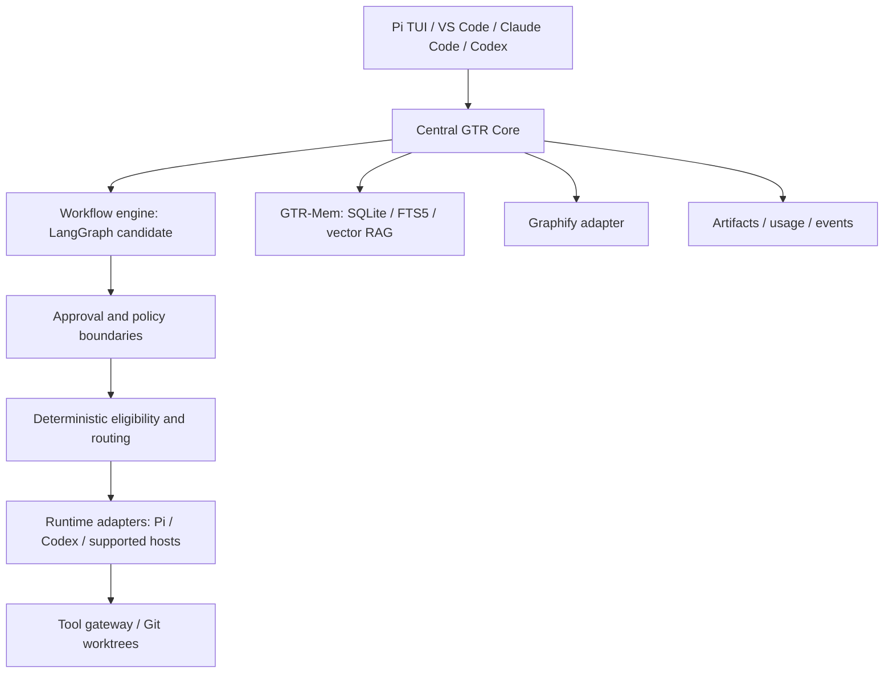

# GTR-AI — Provisional architecture baseline

Status: provisional; approved principles only. Date: 2026-11-25. Production readiness: BLOCKED.

## Product constraints
Open source with potential commercial capabilities; local-first modular monolith; Windows, Linux and macOS; TypeScript/Node and npm distribution; centralized workflow authority with replaceable hosts/runtimes; explicit human approval at every phase; multiple authorized subscriptions/providers; configurable hybrid artifacts; customizable agents, skills and workflows; isolated project memory and explicit global memory; Git worktrees for concurrent writes. Pi, VS Code, Claude Code and Codex are required integration targets. Full SDD (Research, Apply, Verify, Archive), Product Owner (Research, Define, Refine), PR Reviewer, QA Engineer and Planner are required. Ponytail and Graphify are required embedded capabilities; Copilot Auto/Fusion integration is required subject to authorization and actual capabilities. No additional manual managed dependency installation.

## Logical design

## Accepted design invariants
See ADR_REGISTRY.md. Central approvals must be bound to immutable revisions; external side effects reconciled; interrupted worktrees retained; deterministic routing enforces eligibility and authorization; selective retrieval and exact dedup preserve mandatory context and provenance. Prefer authorized subscriptions over automatic paid affinity, subject to explicit authorized user pins and required capabilities. All implementation conditions remain open.

## Candidate technologies (not production selections)
Node 24 LTS target, pnpm, Pi SDK/RPC, LangGraph.js, SQLite binding (node:sqlite vs alternatives), sqlite-vec, Transformers.js/ONNX, multilingual-e5-small, YAML compiler, local daemon versus coordinated CLI, Unix sockets/named pipes, GTR Router adapter (pi-model-router and alternatives), Codex App Server/SDK, RTK conditional on fidelity, Graphify managed Python. Apache 2.0 is a proposed license, subject to review and approval. Three concurrent agents, local telemetry/export, provisioning on demand, Quick/Standard SDD and performance thresholds remain proposed defaults unless separately approved. No dependency versions are pinned by this archive.

## Trust and performance boundaries
Hosts are adapters, not workflow authority. Native host actions outside GTR-AI are not governed. Worktrees are not security sandboxes. No cross-project or cross-provider transfer without policy authorization. No automatic paid fallback. Local prototype evidence does not establish production performance. Use deterministic algorithms before LLM calls, avoid duplicate context and compaction, and measure quality-adjusted usage with real provider metrics when authorized.

## Release gate
Do not approve production implementation of critical integrations until actual dependencies, recovery, platform compatibility and security have been tested and the human approves the resulting baseline. See UNBLOCK_PLAN.md and ARCHITECTURE_RISK_REGISTER.md.
